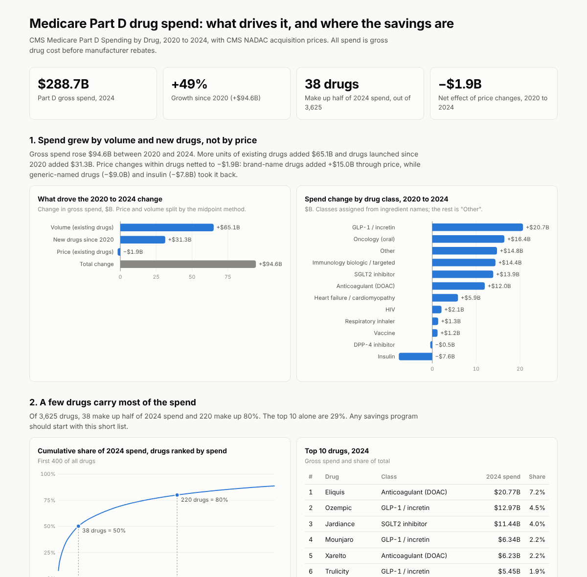

# Pharmacy Spend Analytics

An end-to-end analysis of Medicare Part D drug spend, written for a pharmacy leader: what drove five years of growth, where the savings are, and what 2026 looks like.

**Read first:** [Executive memo](docs/02_executive_memo.md) · [Dashboard](dashboard/index.html) · [Scoping memo](docs/01_scoping_memo.md)



## Key findings

- **Growth was volume, not price.** Gross spend rose $94.6B (+49%) from 2020 to 2024. More units added $65.1B and new drugs $31.3B; price changes netted to −$1.9B, with brand increases (+$15.0B) offset by generics (−$9.0B) and insulin (−$7.8B).
- **Spend is concentrated.** 38 of 3,625 drugs make up half of 2024 spend.
- **Adalimumab biosimilars are barely used.** They had 4.6% of units in 2024 at a far lower price per unit. Switching half of Humira units is worth $1.2B to $2.3B a year, gross.
- **2026 negotiated prices: budget on net.** Applied to gross spend, the ten negotiated prices look like $37.5B in savings. CMS's own estimate, net of rebates, is about $6B.

## How it is built

```
CMS Part D API ─┐                                  ┌─ dashboard/ (HTML, hover tooltips)
                ├─ src/ingest.py ─> DuckDB raw ─> sql/ models ─> marts ─┼─ outputs/marts/*.csv (Tableau / Power BI)
CMS NADAC CSV ──┘                    │                               └─ docs/02_executive_memo.md
                              src/checks.py (11 data checks)
```

| Step | File | What it does |
|---|---|---|
| Ingest | `src/ingest.py` | Downloads both sources, loads them unchanged, records row counts and file hashes |
| Stage | `sql/01_stg_partd.sql`, `sql/02_stg_nadac.sql` | Reshapes Part D to drug x year; fixes NADAC column names that changed between years |
| Reconcile | `sql/03_xwalk_drug_ndc.sql` | Matches Part D drug names to NADAC NDC codes in three tiers; reports coverage by spend |
| Analyze | `sql/04_marts.sql` | Concentration, price/volume decomposition, biosimilar scenarios, negotiated-price impact |
| Forecast | `src/forecast.py` | Three methods compared on a rolling back-test; the winner sets the forecast and its range |
| Check | `src/checks.py` | 11 checks: no lost rows, spend reconciles to source, manufacturer rows sum to totals, match rate |
| Export | `src/export.py` | CSVs for BI tools and the data file for the dashboard |

## Decisions worth noting

- **A check caught a real bug.** CMS hides small beneficiary counts, and DuckDB's UNPIVOT silently dropped every drug-year with a hidden count, about $160M in 2024 alone. The reconciliation check failed, and the step was rewritten so totals now match the source exactly.
- **The crosswalk is scoped by spend.** The 257 drugs covering 80% of spend are matched instead of all 3,625. 99.8% of the in-scope spend that NADAC carries is matched; the drugs NADAC does not survey (specialty, vaccines) are reported separately rather than counted as failures.
- **The forecast method was chosen by back-test.** Constant-percentage growth looked natural but overshot 2024 by 9.5%. A straight-line trend had the lowest error, and its class forecasts add up exactly to the total.
- **Gross vs net is stated everywhere.** Rebates are not public, so every figure is labeled gross and the memo shows where that matters most.

## Run it

```bash
python -m venv .venv && source .venv/bin/activate
pip install -r requirements.txt
python src/ingest.py     # download raw data, build data/pharmacy.duckdb
python src/build.py      # SQL models + data checks
python src/forecast.py   # forecast with back-test
python src/export.py     # CSVs + dashboard data
open dashboard/index.html
```

## Data

- [CMS Medicare Part D Spending by Drug](https://data.cms.gov/summary-statistics-on-use-and-payments/medicare-medicaid-spending-by-drug/medicare-part-d-spending-by-drug) (2020 to 2024)
- [CMS NADAC](https://data.medicaid.gov/dataset/nadac-national-average-drug-acquisition-cost) (weekly, 2023 to 2025 files)
- CMS negotiated prices for 2026 (Medicare Drug Price Negotiation Program fact sheet, August 2024)

Stack: Python, DuckDB, SQL, pandas, NumPy, HTML/SVG.
